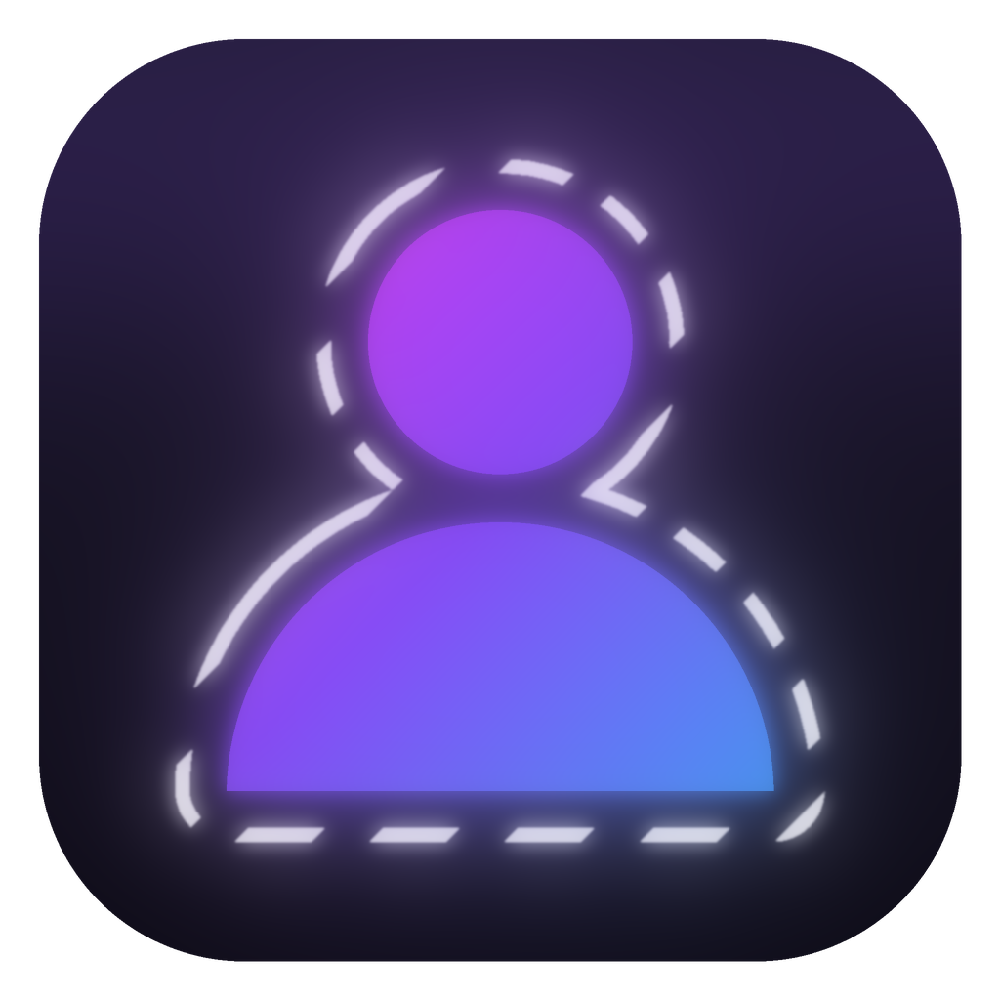
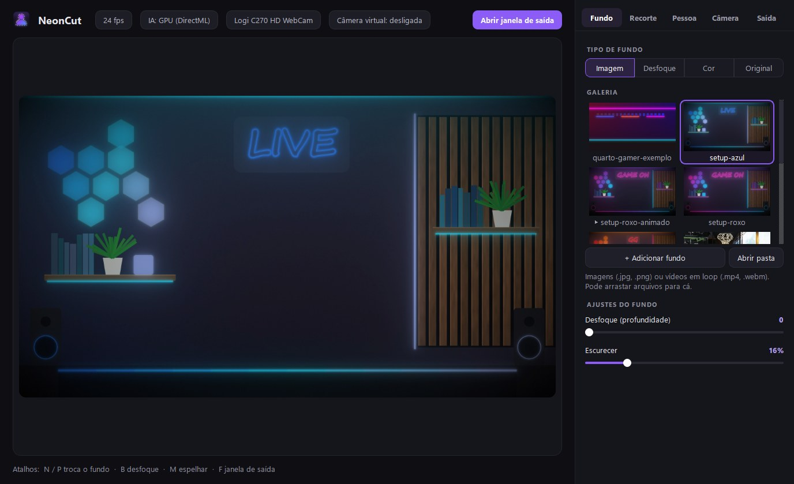

<p align="center">
  
</p>

<h1 align="center">NeonCut</h1>

<p align="center">
  <b>Troque o fundo da webcam sem chroma key.</b><br>
  IA na placa de vídeo recorta você fio a fio. Coloque qualquer fundo e leve direto para o Streamlabs/OBS.
</p>

<p align="center">
  <a href="https://github.com/pedrogiampietro/neoncut/releases/latest/download/NeonCut-Setup.exe"><b>⬇ Baixar para Windows</b></a> ·
  <a href="https://pedrogiampietro.github.io/neoncut/">Site</a> ·
  <a href="#rodar-pelo-código">Rodar pelo código</a>
</p>

<p align="center"></p>

## Recursos

- **Sem chroma key**: o [Robust Video Matting](https://github.com/PeterL1n/RobustVideoMatting) roda na GPU via **DirectML** (NVIDIA, AMD ou Intel) a ~30 fps e recorta cabelo e bordas com transparência real.
- **Remove o reflexo de cor** do fundo nas bordas (usa a cor de primeiro plano estimada pela IA).
- **Limpar sobras**: mantém só você e apaga objetos soltos atrás (cadeira, roupas, pôster).
- **Qualquer fundo**: imagem, vídeo em loop, desfoque do ambiente real ou cor sólida. Já vem com fundos neon gerados pelo próprio projeto.
- **Ajustes**: brilho, contraste, saturação, tamanho e posição sobre o fundo, desfoque de profundidade, exposição fluida a 30 fps.
- **Saída para live**: janela limpa para *Captura de janela* no Streamlabs/OBS e, se houver driver, câmera virtual.
- Sem GPU compatível, cai automaticamente para **MediaPipe** no processador.

## Usar no Streamlabs / OBS

1. **Desative a fonte de webcam** no Streamlabs/OBS: a câmera só pode ser usada por um programa por vez.
2. Abra o NeonCut e escolha o fundo (galeria, ou arraste arquivos; **N / P** troca durante a live).
3. Clique em **Abrir janela de saída**.
4. No Streamlabs/OBS: **+ Fonte → Captura de janela → "NeonCut - Saída"**.

Atalhos: **N / P** fundo · **B** desfoque · **M** espelhar · **F** janela de saída. Clique duplo no número de um ajuste volta ao padrão.

### Dicas

- **Imagem escura?** No modo de exposição *Fluida*, suba o *Ganho* (aba Câmera) ou o *Brilho* (aba Pessoa). O modo *Automática* clareia, mas com pouca luz a webcam cai para 7 a 15 fps.
- **Cara de "colado" em fotos reais?** *Desfoque (profundidade)* entre 4 e 6 imita o desfoque de uma câmera de verdade.
- **Objetos atrás de você aparecendo?** Suba *Limpar sobras* (aba Recorte).

## Rodar pelo código

Requer Python 3.11 no Windows.

```bash
python -m venv .venv
.venv\Scripts\pip install -r requirements.txt
.venv\Scripts\python app.py
```

O modelo `models/rvm_mobilenetv3_fp32.onnx` já está no repositório.

### Gerar fundos neon

```bash
.venv\Scripts\python gerar_fundo.py --tema roxo --texto "GAME ON"
```

Temas: `roxo`, `vermelho`, `verde`, `azul`. Gera uma imagem 1080p e um vídeo animado em loop em `fundos/` (`--sem-video` gera só a imagem).

### Empacotar (exe + instalador)

```bash
.venv\Scripts\pip install pyinstaller
.venv\Scripts\pyinstaller neoncut.spec --noconfirm
"%LOCALAPPDATA%\Programs\Inno Setup 6\ISCC.exe" installer\neoncut.iss
```

Saída: `dist\NeonCut\NeonCut.exe` e `dist\NeonCut-Setup.exe`.

## Como funciona

```
webcam (thread própria, MJPG)
  └─► IA de matting na GPU (Robust Video Matting + DirectML, detalhe 180p/240p/360p, borda refinada em 720p)
        └─► thread de composição (em paralelo com o próximo quadro na GPU)
              limpar sobras → ajustes da pessoa → fundo → mistura
                └─► janela de saída / câmera virtual
```

| Arquivo | O que faz |
|---|---|
| `app.py` | Interface (PySide6/Qt) e janela de saída |
| `engine.py` | Câmera, IA, composição, configurações |
| `gerar_fundo.py` | Gerador procedural de fundos neon (imagem + vídeo em loop) |
| `tools/make_icon.py` | Gera o ícone e as imagens do instalador |
| `neoncut.spec` · `installer/neoncut.iss` | Empacotamento (PyInstaller + Inno Setup) |
| `docs/` | Site (GitHub Pages) |

Configurações e fundos do usuário ficam em `%APPDATA%\NeonCut` (na versão instalada).

## Licença

[GPL-3.0](LICENSE). O modelo Robust Video Matting é GPL-3.0 © Shanchuan Lin et al. MediaPipe (Apache-2.0), ONNX Runtime (MIT), Qt/PySide6 (LGPL-3.0), OpenCV (Apache-2.0).
